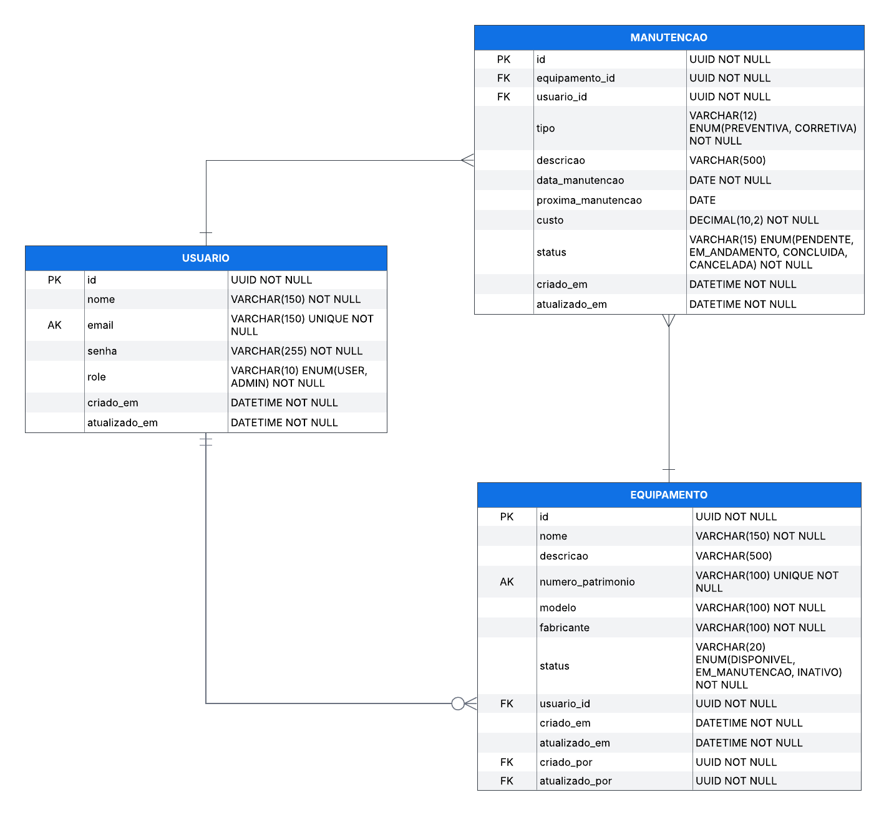

# Maintenance API

API REST para gerenciamento de equipamentos e controle de manutenções, desenvolvida com Java e Spring Boot.

O projeto tem como objetivo centralizar o cadastro de equipamentos, organizar registros de manutenção e permitir o acompanhamento do histórico de cada equipamento.

## Objetivos do projeto

- Gerenciar usuários e níveis de acesso.
- Cadastrar, consultar e atualizar equipamentos.
- Registrar manutenções preventivas e corretivas.
- Manter o histórico de manutenções dos equipamentos.
- Implementar controle de acesso baseado em roles.
- Registrar informações de auditoria.

## Tecnologias

Tecnologias planejadas para o desenvolvimento:

- Java 17+
- Spring Boot
- Spring Data JPA
- Spring Security
- MySQL
- Maven
- Hibernate
- Git e GitHub

## Modelagem do banco de dados

O banco de dados será relacional e contará inicialmente com três entidades principais:

| Entidade    | Responsabilidade                         |
| ----------- | ---------------------------------------- |
| Usuario     | Gerenciamento de usuários e permissões   |
| Equipamento | Cadastro e gerenciamento de equipamentos |
| Manutencao  | Registro e histórico de manutenções      |

### Relacionamentos

- Um usuário pode estar relacionado a vários equipamentos.
- Um usuário pode registrar várias manutenções.
- Um equipamento pode possuir várias manutenções.

### Regras de negócio

- Os usuários terão dois níveis de acesso: `USER` e `ADMIN`.
- Os identificadores das entidades serão UUID.
- Os equipamentos serão compartilhados entre os usuários.
- Usuários autenticados poderão cadastrar e editar equipamentos.
- As permissões administrativas serão aplicadas conforme as regras de acesso da API.

### Diagrama Entidade-Relacionamento

> Em desenvolvimento.




## Auditoria

O projeto prevê auditoria dos registros, incluindo:

- Data de criação.
- Data da última atualização.
- Usuário responsável pela criação.
- Usuário responsável pela última alteração.

A estratégia de auditoria será implementada utilizando os recursos do Spring Data JPA.

## Estrutura do projeto

A estrutura de pacotes será organizada seguindo responsabilidades:

```text
maintenance-api/
├── docs/
│   └── uml/
├── src/
│   ├── main/
│   │   ├── java/
│   │   └── resources/
│   └── test/
├── pom.xml
└── README.md
```

## Planejamento de desenvolvimento

- [x] Configuração inicial do projeto Spring Boot.
- [ ] Configuração da conexão com MySQL.
- [ ] Modelagem das entidades e relacionamentos.
- [ ] Implementação das entidades JPA.
- [ ] Implementação do CRUD de usuários.
- [ ] Implementação do CRUD de equipamentos.
- [ ] Implementação do módulo de manutenções.
- [ ] Implementação da autenticação e autorização com Spring Security.
- [ ] Implementação da auditoria.
- [ ] Criação de testes automatizados.
- [ ] Documentação da API com Swagger/OpenAPI.

## Status do projeto

Em desenvolvimento.

---

Desenvolvido como projeto de estudo e portfólio Backend Java.
