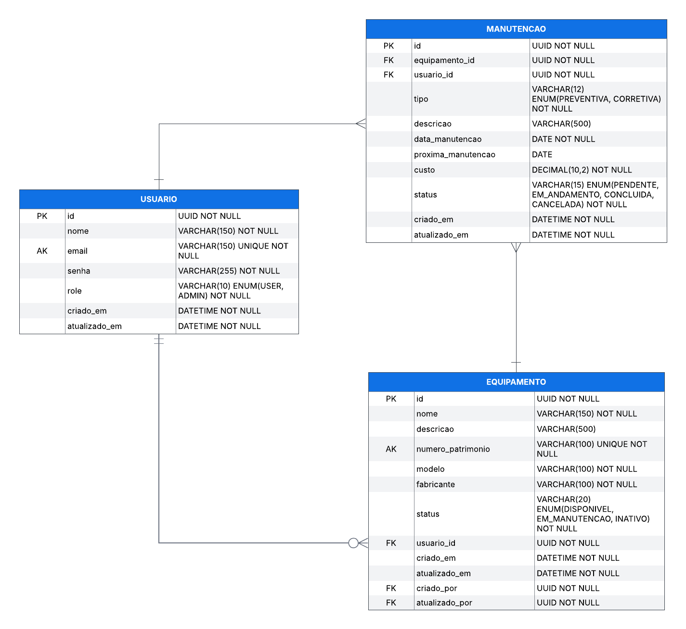

# Maintenance API

## Autenticação e autorização

A API usa Spring Security stateless. O cadastro público em `POST /api/v1/users` cria sempre um usuário `USER`. Login em `POST /api/v1/auth/login` retorna Access Token JWT (15 minutos por padrão) e Refresh Token (7 dias por padrão). Envie o Access Token como `Authorization: Bearer <accessToken>` às rotas CRUD. `POST /api/v1/auth/refresh` rotaciona os refresh tokens; reutilizar um token revogado invalida toda a família da sessão. `POST /api/v1/auth/logout` revoga o token recebido e é idempotente. `GET /api/v1/auth/me` retorna a identidade autenticada.

Todos os endpoints `/api/v1/**` exceto login, refresh, logout e cadastro de usuário exigem um usuário com role `USER` ou `ADMIN`. Não há operações administrativas exclusivas definidas nesta versão. HTTP Basic e sessões HTTP estão desabilitados. O CORS não libera origens por padrão; defina uma lista explícita separada por vírgula quando necessário.

Senhas novas são armazenadas com BCrypt. Refresh Tokens são gerados aleatoriamente e apenas o SHA-256 é persistido. Não há migração automática para senhas legadas em texto puro: esses usuários não conseguem autenticar e devem receber uma redefinição de senha por um processo operacional confiável antes de usar o login. O encoder rejeita valores que não tenham formato BCrypt e nunca tenta compará-los como texto puro.

### Variáveis de ambiente

- `DATABASE_URL`, `DATABASE_USERNAME`, `DATABASE_PASSWORD`: conexão MySQL já utilizada pelo ambiente normal.
- `JWT_SECRET_BASE64`: chave aleatória codificada em Base64, com pelo menos 32 bytes após decodificar. Gere uma chave segura com `openssl rand -base64 32`; não a versione.
- `JWT_ACCESS_EXPIRATION_MS`: duração do JWT em milissegundos (padrão `900000`).
- `JWT_REFRESH_EXPIRATION_MS`: duração do refresh token em milissegundos (padrão `604800000`).
- `CORS_ALLOWED_ORIGINS`: origens permitidas separadas por vírgula; vazio por padrão.

Como `spring.jpa.hibernate.ddl-auto=validate` permanece ativo no MySQL, aplique uma vez o script [create_refresh_tokens_mysql.sql](src/main/resources/db/create_refresh_tokens_mysql.sql) no banco antes de iniciar esta versão. Os testes usam valores JWT próprios no perfil `test` e H2 em memória.

### Exemplos de uso no Postman

1. Cadastre um usuário com `POST /api/v1/users`: `{"name":"Usuário Teste","email":"usuario@example.com","password":"Senha@123"}`.
2. Faça login em `POST /api/v1/auth/login` com `{"email":"usuario@example.com","password":"Senha@123"}` e guarde `accessToken` e `refreshToken`.
3. Use `Authorization: Bearer <accessToken>` em `/api/v1/auth/me` e nos endpoints de usuários, equipamentos e manutenções.
4. Envie `{"refreshToken":"<refreshToken>"}` a `POST /api/v1/auth/refresh`, substituindo ambos os tokens pelos valores retornados.
5. Envie o refresh token atual a `POST /api/v1/auth/logout` para encerrar a sessão.

API REST para gerenciamento de equipamentos e controle de manutenções, desenvolvida com Java e Spring Boot.

O projeto tem como objetivo centralizar o cadastro de equipamentos, organizar registros de manutenção e permitir o acompanhamento do histórico de cada equipamento.

## Objetivos do projeto

- Gerenciar usuários e níveis de acesso.
- Cadastrar, consultar e atualizar equipamentos.
- Registrar manutenções preventivas e corretivas.
- Manter o histórico de manutenções dos equipamentos.
- Implementar controle de acesso baseado em roles.
- Registrar informações de auditoria.

## Tecnologias

Tecnologias planejadas para o desenvolvimento:

- Java 17+
- Spring Boot
- Spring Data JPA
- Spring Security
- MySQL
- Maven
- Hibernate
- Git e GitHub

## Modelagem do banco de dados

O banco de dados será relacional e contará inicialmente com três entidades principais:

| Entidade    | Responsabilidade                         |
| ----------- | ---------------------------------------- |
| Usuario     | Gerenciamento de usuários e permissões   |
| Equipamento | Cadastro e gerenciamento de equipamentos |
| Manutencao  | Registro e histórico de manutenções      |

### Relacionamentos

- Um usuário pode estar relacionado a vários equipamentos.
- Um usuário pode registrar várias manutenções.
- Um equipamento pode possuir várias manutenções.

### Regras de negócio

- Os usuários terão dois níveis de acesso: `USER` e `ADMIN`.
- Os identificadores das entidades serão UUID.
- Os equipamentos serão compartilhados entre os usuários.
- Usuários autenticados poderão cadastrar e editar equipamentos.
- As permissões administrativas serão aplicadas conforme as regras de acesso da API.

### Diagrama Entidade-Relacionamento

> Em desenvolvimento.




## Auditoria

O projeto prevê auditoria dos registros, incluindo:

- Data de criação.
- Data da última atualização.
- Usuário responsável pela criação.
- Usuário responsável pela última alteração.

A estratégia de auditoria será implementada utilizando os recursos do Spring Data JPA.

## Estrutura do projeto

A estrutura de pacotes será organizada seguindo responsabilidades:

```text
maintenance-api/
├── docs/
│   └── uml/
├── src/
│   ├── main/
│   │   ├── java/
│   │   └── resources/
│   └── test/
├── pom.xml
└── README.md
```

## Planejamento de desenvolvimento

- [x] Configuração inicial do projeto Spring Boot.
- [x] Configuração da conexão com MySQL.
- [x] Modelagem das entidades e relacionamentos.
- [x] Implementação das entidades JPA.
- [x] Implementação do CRUD de usuários.
- [x] Implementação do CRUD de equipamentos.
- [x] Implementação do módulo de manutenções.
- [ ] Implementação da autenticação e autorização com Spring Security.
- [ ] Implementação da auditoria.
- [x] Criação de testes automatizados.
- [ ] Documentação da API com Swagger/OpenAPI.

## Status do projeto

Em desenvolvimento.

---

Desenvolvido como projeto de estudo e portfólio Backend Java.
